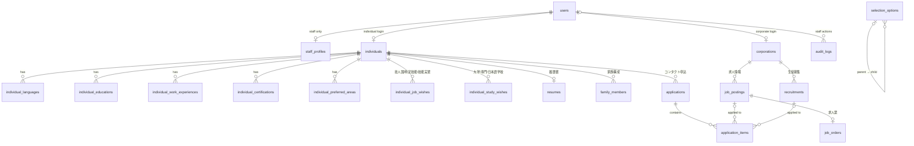

# Bhalojob database guide (PostgreSQL 18 + pgAdmin 4)

This guide creates the Bhalojob database on your PC: the login user and the database in pgAdmin 4, then all 22 tables and every relationship between them with one command.

The app talks to the database through **Prisma** (version 7). Prisma owns the table structure: it lives in `prisma/schema.prisma` and in the migration files under `prisma/migrations/`. Every table, column and rule is also listed in **[database-tables.md](database-tables.md)**. Problems found in the Excel definition are in **[spreadsheet-review.md](spreadsheet-review.md)**.

| File | What it does | Command |
|---|---|---|
| `prisma/migrations/0_init/migration.sql` | Creates all tables, relationships, rules and indexes (the former `db/schema.sql`) | `npm run db:deploy` |
| `db/seed.sql` | Fills the dropdown lists (選択項目マスタ), popular industries and settings | `npm run db:seed`, once |
| `db/sample-data.sql` | Adds 1 test candidate, 1 company with 2 jobs, 1 school, 1 contact request | `npm run db:sample`, optional, **local PC only** |

Run all commands in a terminal in `E:\Bhalojob.com\bhalojob-web`.

---

## Step 1. Create the app's login user

1. Open **pgAdmin 4** from the Start menu.
2. In the left panel, open **Servers → PostgreSQL 18**. Enter the `postgres` password you chose when installing.
3. Right-click **Login/Group Roles → Create → Login/Group Role…**
4. **General** tab → Name: `balojob`
5. **Definition** tab → Password: choose one and write it down.
6. **Privileges** tab → switch on **Can login?** and **Create databases?**
   (The second one lets Prisma create a temporary database when it checks migrations later.)
7. Click **Save**.

## Step 2. Create the database

1. Right-click **Databases → Create → Database…**
2. **General** tab:
   - Database: `balojob`
   - Owner: `balojob` ← important, otherwise the app can't change its own tables
3. **Definition** tab → Encoding: `UTF8` (the default).
4. Click **Save**.

## Step 3. Connect as the `balojob` user

The tables must be **owned by `balojob`**, not by `postgres`. The simplest way is to add a second connection that logs in as `balojob`:

1. Right-click **Servers → Register → Server…**
2. **General** tab → Name: `Bhalojob (local)`
3. **Connection** tab:
   - Host name/address: `localhost`
   - Port: `5432`
   - Maintenance database: `balojob`
   - Username: `balojob`
   - Password: the password from Step 1. Tick **Save password?**
4. Click **Save**.

From now on, always work under **Bhalojob (local)**.

## Step 4. Tell the app where the database is

1. Copy `.env.example` to `.env.local` (same folder).
2. In `.env.local`, replace `YOUR_PASSWORD` with the password from Step 1.
3. Set `APP_ENCRYPTION_KEY` to a random key (the command to generate one is in the file). It encrypts passport numbers; without it that one field is disabled.

Both the app (`npm run dev`) and the Prisma commands read `.env.local`. Git ignores it: never commit it.

## Step 5. Create the tables and relationships

```bash
npm run db:deploy
npm run db:seed
npm run db:sample
```

1. `db:deploy` creates the tables: 22 from `0_init`, plus `staff_credentials` / `staff_sessions` (admin login), `member_credentials` / `member_sessions` (candidate and employer login) and `uploaded_files` (résumés and photos). It prints `All migrations have been successfully applied.`
2. `db:seed` fills the dropdown lists. It refuses to run a second time, so the lists can't be duplicated.
3. `db:sample` (optional, local PC only) adds the test rows, including an admin console account (login ID and password at the top of `db/sample-data.sql`).

In pgAdmin, right-click **balojob → Refresh** and open **Schemas → public → Tables**: you should see **27 tables** plus `_prisma_migrations`, where Prisma records which migrations it has applied.

Then open http://localhost:3000/admin. With no staff account yet, the page offers to create the first Administrator; with the sample data, log in with the test account. Every table can be filled from there (see [admin-console.md](admin-console.md)).

Each file runs as one transaction, so if something fails nothing is half-created. Read the error, fix it, and run the command again. To start over completely, see "Reset" at the bottom.

### Already created the tables in pgAdmin from the old `db/schema.sql`?

Then the tables exist, but Prisma doesn't know about them. Don't run `db:deploy`. Instead, tell Prisma the first migration is already applied, then check that nothing differs:

```bash
npx prisma migrate resolve --applied 0_init
npm run db:migrate
```

The second command should print `Already in sync, no schema change or pending migration was found.` If it reports drift instead, your tables differ from `0_init` (for example after a change clicked in pgAdmin). Reset the database (see the bottom) and use Step 5.

## Step 6. See the relationships (ER diagram)

Right-click **balojob → ERD For Database**. pgAdmin draws every table with lines for the relationships. You can drag tables around and use **Save** to keep the layout, or export it as an image.

To look at data, right-click a table → **View/Edit Data → All Rows**.

Try this query in the Query Tool to see relationships in action (needs the sample data):

```sql
SELECT i.member_no, i.full_name, ai.target_label, a.status, a.created_at
FROM applications a
JOIN individuals i        ON i.id = a.individual_id
JOIN application_items ai ON ai.application_id = a.id;
```

---

## The tables

### Diagram



### What each table is, and where it came from

| Table | Purpose | Old name (オブジェクト定義書) | Screens |
|---|---|---|---|
| `users` | One row per login (individual, corporate or staff) | ログインマスタ + ユーザマスタ | BHALO001–003 |
| `staff_profiles` | Admin permissions: admin / view / edit / delete | ユーザマスタ | BHALO810–811 |
| `staff_credentials` | Staff password hashes (scrypt); added by migration `staff_auth` | ログインマスタ | BHALO811, 813 |
| `staff_sessions` | Admin console sessions (hash of the cookie token, expiry) | — | — |
| `member_credentials` | Candidate / employer password hashes (scrypt); migration `member_auth_and_reviews` | ログインマスタ | BHALO001–003 |
| `member_sessions` | Member sessions (hash of the cookie token `bj_member`, expiry) | — | — |
| `uploaded_files` | Résumé / photo files: owner, kind, size, type, storage key (bytes live in `storage/` locally, S3 later) | 画像情報 | BHALO012, 201 |
| `individuals` | Candidate profile, address, visa, photo, goals | 個人会員情報 | BHALO010–019 |
| `individual_languages` | Languages and levels | 言語 | BHALO014 |
| `individual_educations` | Education history | 学歴 | BHALO015 |
| `individual_work_experiences` | Work history | 実務経験 | BHALO016 |
| `individual_certifications` | Certifications | 認定資格 | BHALO017 |
| `individual_preferred_areas` | Preferred countries and regions | 希望地域 | BHALO020 |
| `individual_job_wishes` | Job wishes; `track` = engineer / ssw / titp | 技人国 + 特定技能 + 技能実習 | BHALO021–023 |
| `individual_study_wishes` | Study wishes; `school_category` = university / vocational / language_school | 大学大学院 + 専門学校 + 日本語学校 | BHALO024–026 |
| `resumes` | Extra resume fields (height, religion, passport…) | 履歴書情報 | BHALO201 |
| `family_members` | Family | 家族構成 | BHALO202 |
| `corporations` | Company or school profile; `kind` = company / school | 法人会員情報 | BHALO110–154 |
| `job_postings` | Job postings | 求人情報 | BHALO115–116 |
| `job_orders` | Job order (求人票) details for one posting | 求人票 | BHALO117 |
| `recruitments` | Student recruitment per faculty/department | 生徒募集情報 | BHALO155–156 |
| `applications` | A contact request from a candidate, with a status | (new; the spec only sent an email) | BHALO200 |
| `application_items` | Which jobs/schools the request was for | (new) | BHALO200 |
| `selection_options` | Dropdown values, two levels via `parent_id` | 選択項目マスタ | BHALO812 |
| `popular_industries` | 人気の業種 list | 人気業種 | BHALO815 |
| `site_settings` | Where contact requests are emailed | 管理マスタ | BHALO816 |
| `audit_logs` | Which staff member viewed or changed which record | (new; needed for personal data) | — |

**採番マスタ is gone.** Member numbers are generated automatically by two PostgreSQL sequences, `individual_member_seq` and `corporate_member_seq`:
- `10` + YYMM + 6 digits for individuals, e.g. `102610000001`
- `20` + YYMM + 6 digits for corporations

### The relationships, in words

| Parent → child | Type | When the parent is deleted |
|---|---|---|
| `users` → `individuals` / `corporations` / `staff_profiles` | one-to-one | Child is deleted |
| `individuals` → languages, educations, work, certifications, areas, job wishes, study wishes, family, applications | one-to-many | Children are deleted |
| `individuals` → `resumes` | one-to-one | Deleted |
| `corporations` → `job_postings`, `recruitments` | one-to-many | Deleted |
| `job_postings` → `job_orders` | one-to-one | Deleted |
| `applications` → `application_items` | one-to-many | Deleted |
| `job_postings` / `recruitments` → `application_items` | one-to-many | The link is cleared, but the item keeps its saved label (`target_label`) so the request history survives |
| `selection_options` → `selection_options` (業種 → 職種, 日本語 → N1–N5, 学部 → 学科) | one-to-many, same table | Children are deleted |

So deleting a user deletes everything that belongs to them, which is what "delete my account" needs. I tested this.

### Rules the database enforces

- **審査 (review).** `job_postings`, `individuals` and `applications` carry `review_status` (pending / approved / rejected), `submitted_at`, `reviewed_at`, `reviewed_by` and `rejection_reason`. Only approved jobs are public; only approved applications reach the employer. Rows entered by staff are approved on creation.
- One application per candidate per job: unique `(individual_id, job_posting_id)` on `applications`.
- `uploaded_files`: 10 MB maximum, PDF / JPEG / PNG only (CHECK constraints, also enforced by the app).

- Email addresses in `users` are unique.
- A company can't have two jobs with the same `job_no`. The same goes for `recruitment_no`.
- `ssw_test` (exam status) is only allowed on 特定技能 wishes.
- `university_level` (大学 / 大学院) is only allowed on university study wishes.
- A corporation must tick at least one organisation type.
- No negative salaries, capacity, headcount or children.
- `updated_at` is set automatically whenever a row changes.

### Design decisions you should know about

- **IDs.** Every table has a numeric `id`, and relationships use it. The 12-digit member number is for display only, so it can change format without breaking links.
- **Times are UTC on the wire.** The app opens every connection with `TimeZone=UTC` (`src/server/db.ts`), because Prisma reads and writes timestamps as UTC. On a Japanese PC PostgreSQL defaults to `Asia/Tokyo`, which shifted app-written timestamps by nine hours until this was pinned. Screens convert to JST when they display a date.
- **Dropdown values are stored as text**, not as links to `selection_options`. The specs allow typing your own value when the list has nothing suitable (選択 or 手入力), and a strict link can't hold free text.
- **Files are not stored in the database.** Photos, logos and videos will go to file storage (S3). The database keeps only the file's key (`photo_key`, `logo_key`, `appeal_video_key`).
- **Member passwords are not stored in these tables.** The login library (Better Auth) adds its own tables for sessions and password hashes when member login is built. Staff passwords are in `staff_credentials`, hashed with scrypt.
- **Sensitive data.** `resumes.passport_no` must be encrypted by the app before saving. `resumes.religion` counts as 要配慮個人情報 (sensitive personal information under Japan's privacy law, APPI) and needs explicit consent.

---

## Adding or changing tables later

Don't change tables by clicking in pgAdmin. Prisma would see a difference it didn't make ("drift"), and the change would exist only on your PC.

1. Edit `prisma/schema.prisma`. Models use camelCase names in the code and map to the snake_case table and column names with `@map` / `@@map`, for example:
   ```prisma
   interviewAt DateTime? @map("interview_at") @db.Timestamptz(6)
   ```
2. Run `npm run db:migrate`. Prisma asks for a name (e.g. `add_interview_date`), writes `prisma/migrations/<date>_add_interview_date/migration.sql`, applies it to your database and regenerates the TypeScript client.
3. Read the generated SQL, then commit it together with `schema.prisma`.
4. On the server, `npm run db:deploy` applies the same files.

`db:migrate` needs the `balojob` user's **Create databases?** privilege (Step 1), because it checks the migrations in a temporary "shadow" database.

### Things Prisma can't describe

`schema.prisma` can't express these, so they exist only in the migration SQL (`0_init`):

- the CHECK rules (no negative salaries, `ssw_test` only for 特定技能, at least one organisation type, …)
- the `set_updated_at()` trigger on each table with `updated_at`
- the two member-number sequences

Prisma leaves them alone, so they keep working. When you add a new table with `updated_at`, add its trigger by hand: run `npm run db:migrate -- --create-only`, add these lines to the end of the new `migration.sql`, then run `npm run db:migrate` again to apply it.

```sql
CREATE TRIGGER new_table_set_updated_at BEFORE UPDATE ON new_table
  FOR EACH ROW EXECUTE FUNCTION set_updated_at();
```

pgAdmin is still the place to view data, run queries and draw the ER diagram. `npm run db:studio` opens Prisma Studio, a simpler data browser.

---

## Reset (local PC only)

This deletes **every table and all data** in the `balojob` database. Run it in the Query Tool under **Bhalojob (local)**:

```sql
DROP SCHEMA public CASCADE;
CREATE SCHEMA public AUTHORIZATION balojob;
```

Then run Step 5 again.
